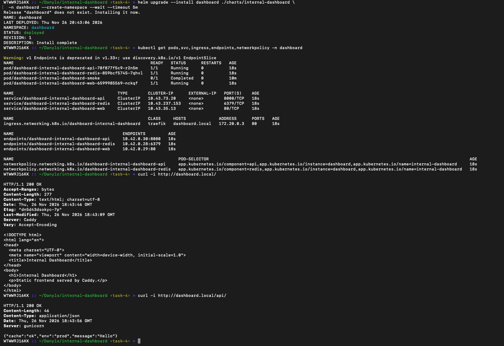
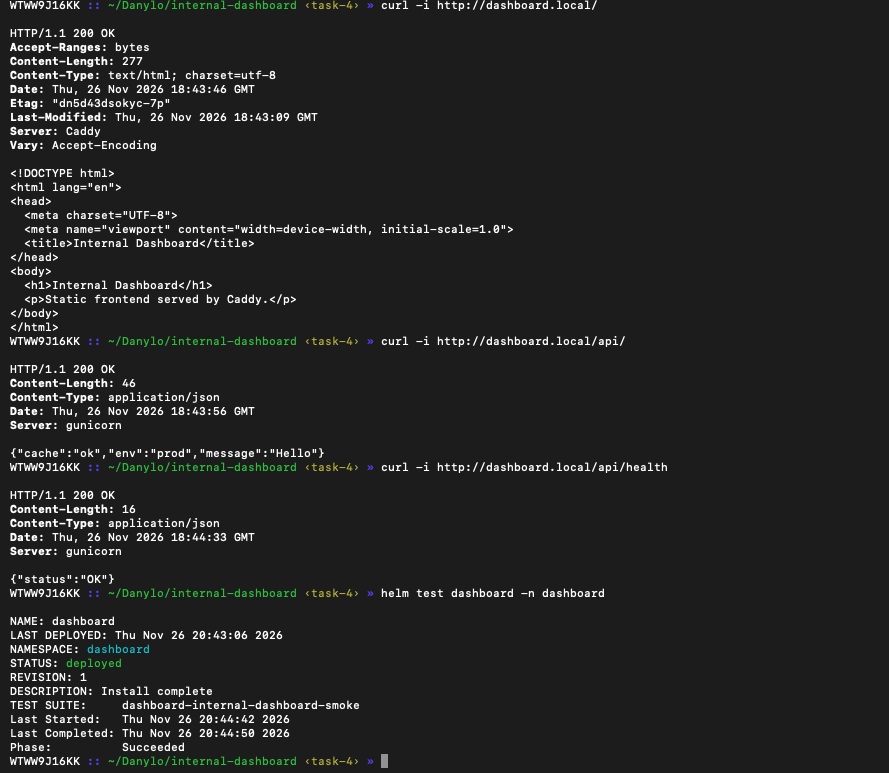

# Internal Dashboard — Troubleshooting Report

## TASK-2 — API

[Pull Request #2](https://github.com/ignat24/internal-dashboard/pull/2)

| Симптом | Причина | Fix |
|---|---|---|
| `ImagePullBackOff` | Спроба завантажити локальний образ із registry | `imagePullPolicy: IfNotPresent` |
| `CreateContainerConfigError` | Некоректний ключ Secret | `redis-uri` → `redis-url` |
| Gunicorn не запускається | Недоступний для запису `/tmp` | Додано `emptyDir` для `/tmp` |
| Невідповідність портів API | Gunicorn слухає `8000`, probes очікують `8080` | Змінено порт Gunicorn на `8080` |
| `OOMKilled` | Недостатній memory limit (`16Mi`) | Request `64Mi`, limit `128Mi` |
| `KeyError: APP_ENV` | Використано `APP_MODE` замість `APP_ENV` | Виправлено конфігурацію `APP_ENV` |
| Gunicorn не знаходить application | Некоректне посилання на Flask application | `main:application` → `main:app` |
| Рестарти API при недоступності Redis | Переплутано liveness та readiness endpoints | Liveness: `/api/health`, readiness: `/api/ready` |
| Redis недоступний | Некоректний порт у NetworkPolicy | Встановлено порт `6379` |

## TASK-3 — Web та Ingress

[Pull Request #3](https://github.com/ignat24/internal-dashboard/pull/3)

| Симптом | Причина | Fix |
|---|---|---|
| Некоректна маршрутизація API Service | `targetPort` не відповідає порту Gunicorn | `8000` → `8080` |
| HTTP 503 | Service selector не відповідає labels API pod | `backend` → `api` |
| `ImagePullBackOff` frontend | Спроба завантажити локальний образ із registry | `imagePullPolicy: IfNotPresent` |
| HTTP 404 для API | Traefik видаляє префікс `/api` | `stripApiPrefix: false` |
| HTTP 502 для Web | Service направляє трафік на `8080`, Caddy слухає `80` | `targetPort: 80` |
| HTTP 404 для Web | Caddy використовує неправильний document root | `/srv/www/build` → `/srv/www/dist` |

## TASK-4 — Продуктивність та CI

[Pull Request #4](https://github.com/ignat24/internal-dashboard/pull/4)

### Smoke tests

| Симптом | Причина | Fix |
|---|---|---|
| Smoke tests не проходили через timeout під час паралельних запитів | Один синхронний Gunicorn worker обробляв запити послідовно | Налаштовано `gthread`: 1 worker, 4 threads |

### CI

Раніше CI перевіряв лише збірку Docker-образів. Додано:

- Збірку та тегування API і frontend образів із `--load`.
- Перевірку Helm chart (`helm lint`).
- Створення k3d-кластера та імпорт Docker-образів.
- Розгортання застосунку через Helm та запуск smoke tests (`helm test`).
- Збір діагностики при помилках і видалення тестового кластера.

## Результати локального тестування

- API, Web та Redis — `Running`, без рестартів після повторного розгортання.
- `/`, `/api/`, `/api/health` — HTTP 200; Redis cache — `ok`.
- `helm test` — `Succeeded`: 40 запитів, 20 паралельно, за 2 с (ліміт 4 с).
- Умови тестування, механізми безпеки та ресурсні обмеження збережено; вихідний код застосунку не змінено.

### Розгортання та стан ресурсів

### Перевірка endpoints та smoke test

